# Apartmanım — Site Yönetim Uygulaması

Apartman ve site yöneticileriyle sakinleri bir araya getiren mobil uygulama.
Herkes kendi sitesini kurabilir; her sitenin verisi birbirinden tamamen ayrıdır.

Mobil Programlama dersi projesi olarak React Native (Expo) ve Node.js ile geliştirilmiştir.

## Ekran görüntüleri

**Giriş öncesi**

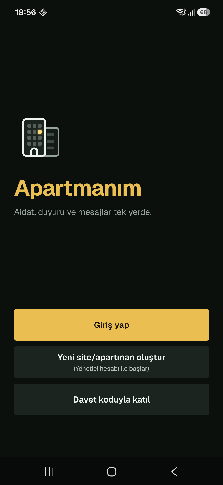 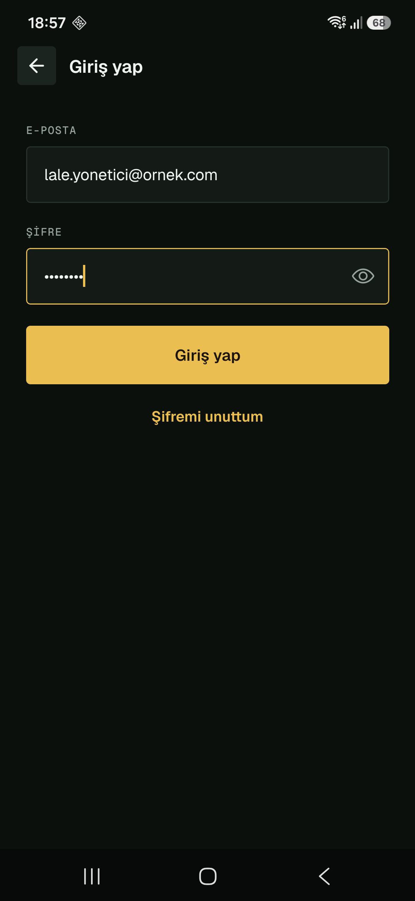

**Yönetici**

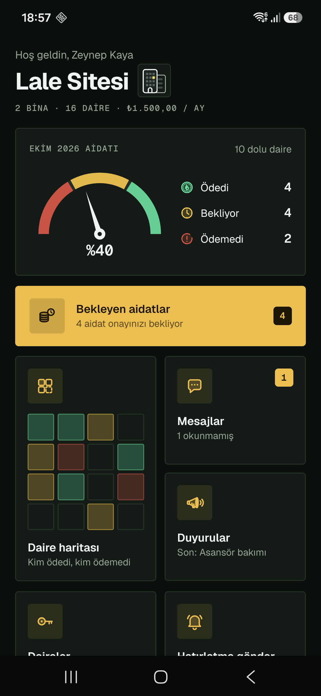 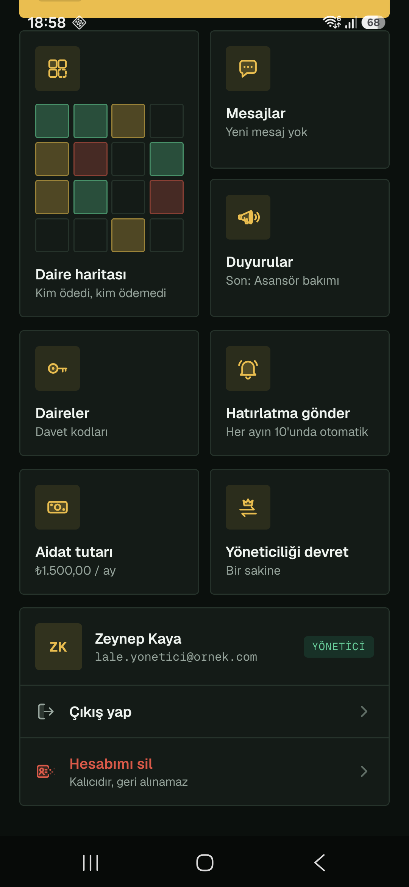 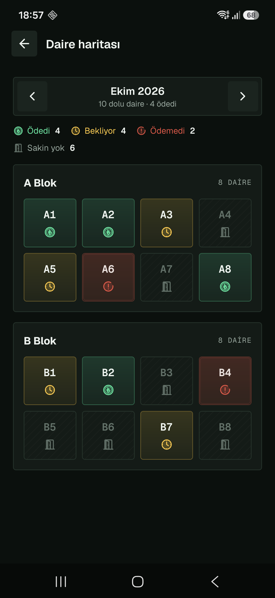 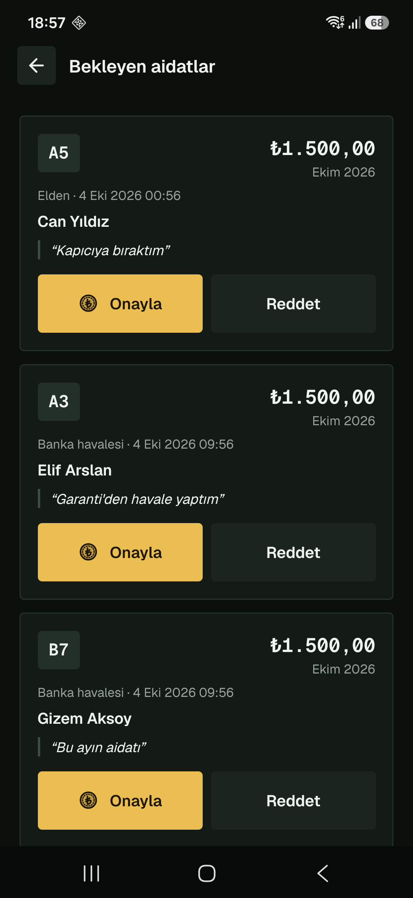

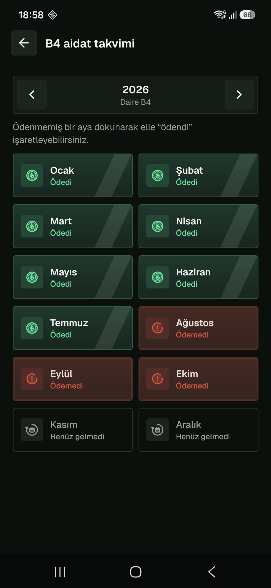 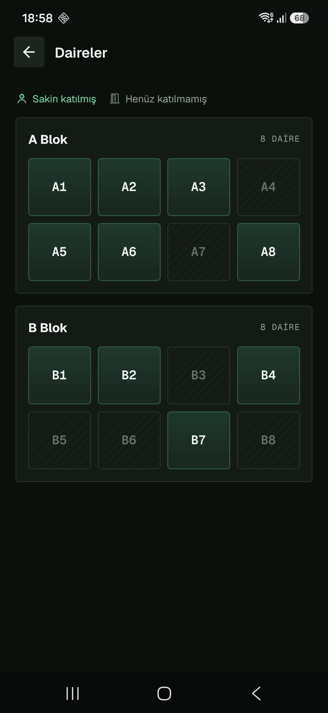 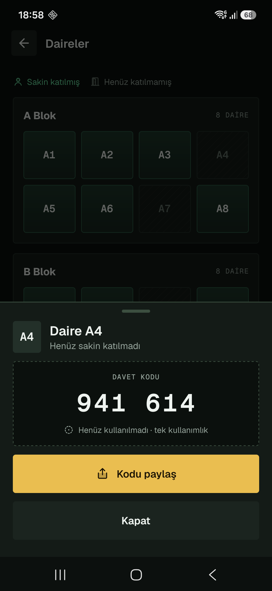 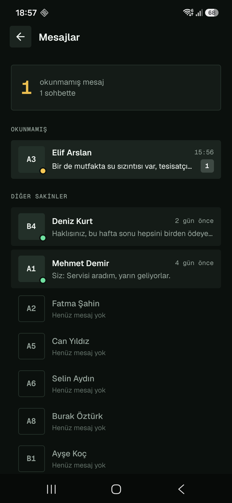

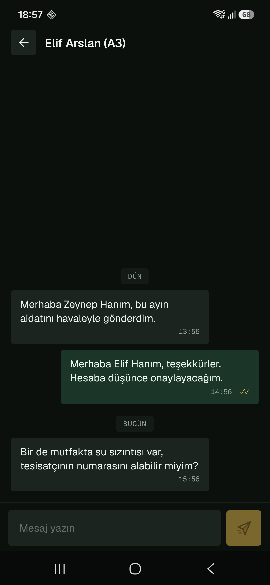 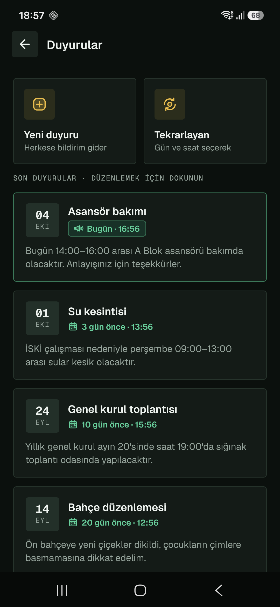

**Sakin**

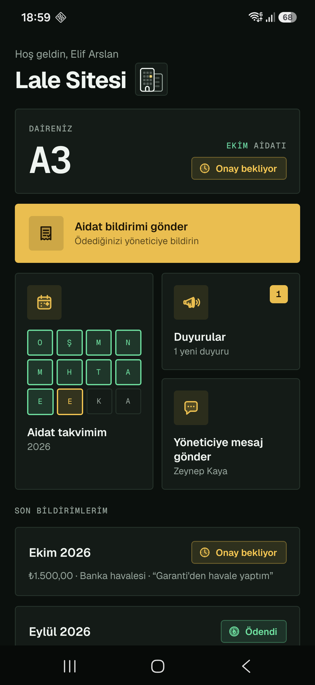 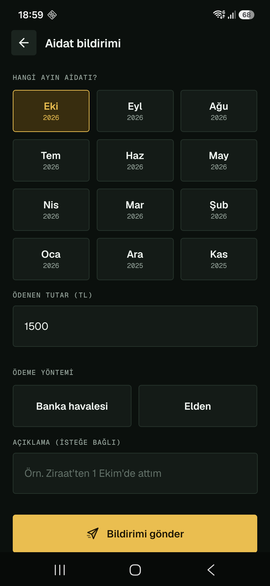 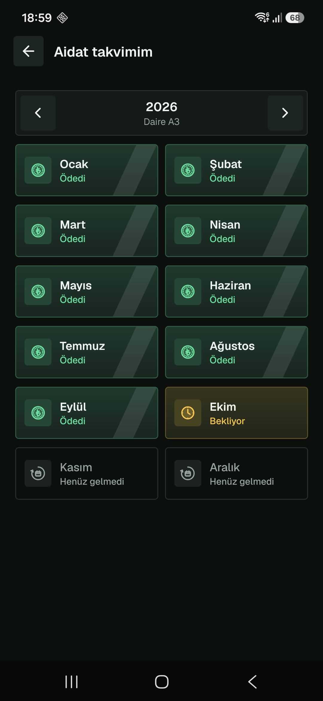

## Özellikler

**Hesap ve site**
- Yeni site oluşturma (kuran kişi yönetici olur), davet koduyla katılma (her dairenin tek kullanımlık 6 haneli kodu)
- Giriş / çıkış, uygulama açılınca kayıtlı oturumla otomatik giriş, "Şifremi unuttum" (e-postaya gelen kodla)
- Bina ve daire kurulumu (örn. 3 bina × 12 daire → A1–C12), davet kodunu paylaşma
- Sakini daireden çıkarma (daireye yeni kod üretilir), yöneticiliği bir sakine devretme (geçmiş korunur)
- Hesabı kalıcı olarak silme (aidat geçmişi daireye bağlı kalır, kişisel veriler silinir)
- Her sitenin verisi tamamen ayrı: bir sitedeki kimse başka sitenin verisini göremez

**Aidat**
- Sakin "aidatı verdim" bildirimi gönderir (ay, tutar, banka havalesi / elden, açıklama)
- Yönetici bildirimleri onaylar veya reddeder; sonuç sakine bildirim olarak gider
- Renkli daire haritası (yeşil = ödedi, sarı = onay bekliyor, kırmızı = ödemedi) ve ana ekranda tahsilat göstergesi
- Daire bazında yıllık aidat takvimi; yönetici bir ayı elle "ödendi" işaretleyebilir
- Her ayın 10'unda ödemeyen dairelere otomatik hatırlatma (ve elle "Hatırlatma gönder" butonu)

**Duyuru ve mesaj**
- Duyurular (yazma, düzenleme, silme); her duyuru sitedeki telefonlara push bildirim olarak gider
- Tekrarlayan duyurular (örn. "Her pazartesi 08:00 · Çöp günü")
- Yönetici ile sakin arasında anlık mesajlaşma (Socket.io), ✓ iletildi / ✓✓ görüldü, uygulama kapalıyken mesaj bildirimi

**Kullanıcı deneyimi**
- Sunucuya ulaşılamayınca ekranın altında "bağlantı yok" uyarısı, bağlantı gelince kendiliğinden kaybolur
- Listelerde aşağı çekip yenileme, her ekranda yükleniyor / boş liste / hata + "Tekrar dene" durumları
- "Gece Gold" koyu tema, gömülü Geist yazı tipleri, özel SVG ikonlar ve açılış animasyonu

## Teknolojiler

| Katman | Teknoloji |
|---|---|
| Mobil | React Native (Expo), React Navigation, axios, expo-secure-store, socket.io-client, expo-notifications, react-native-keyboard-controller |
| Tasarım | react-native-reanimated (animasyonlar), react-native-svg (özel ikonlar), Geist / Geist Mono yazı tipleri, expo-splash-screen |
| Backend | Node.js, Express, zod (veri doğrulama), Socket.io (anlık mesajlaşma), node-cron (zamanlanmış görevler), nodemailer (e-posta) |
| Giriş | JWT, bcrypt |
| Güvenlik | helmet, CORS, express-rate-limit, MongoDB enjeksiyon koruması |
| Veritabanı | MongoDB Atlas, Mongoose |
| Push bildirim | Expo Push Service + Firebase Cloud Messaging (ücretsiz) |

Sunumda uygulamanın nasıl gösterileceği [SUNUM.md](SUNUM.md) dosyasındadır.

## Hazır APK

Android telefona doğrudan kurulabilen APK, GitHub'daki **Releases** sayfasındadır (`Apartmanim-v1.0.0.apk`).

- APK, backend'e derlendiği bilgisayarın yerel IP adresiyle (`mobile/.env` içindeki `EXPO_PUBLIC_API_URL`) bağlanır.
  Bu yüzden sadece backend'in çalıştığı bilgisayarla **aynı Wi-Fi ağındaki** telefonlarda çalışır. Kendi
  bilgisayarınızda kullanmak için `.env`'deki IP'yi değiştirip APK'yı aşağıdaki adımlarla yeniden derleyin.
- Backend yerel ağda `http` ile çalıştığı için APK'da şifresiz bağlantı izni açıktır (`mobile/plugins/httpIzni.js`).
  Giriş bilgileri yerel ağda şifrelenmeden gider; APK sunum/test amaçlıdır ve geliştirme (debug) anahtarıyla imzalıdır.
- Kurulum: APK'yı telefona indirin, "Bilinmeyen kaynaklardan yükleme" iznini verip açın.

APK'yı yeniden derlemek (mobil kurulum adımları yapıldıktan sonra, `mobile` klasöründe):

```bash
npx expo prebuild --platform android
```

```bash
cd android && ./gradlew assembleRelease -PreactNativeArchitectures=arm64-v8a
```

Çıktı: `mobile/android/app/build/outputs/apk/release/app-release.apk`

## Kurulum

### Gereksinimler

- Node.js 20.6 veya üzeri
- Ücretsiz bir MongoDB Atlas hesabı
- Android Studio (Android SDK ve JDK 17+); `ANDROID_HOME` ve `JAVA_HOME` ortam değişkenleri ayarlı
- Geliştirici seçenekleri ve USB/kablosuz hata ayıklaması açık bir Android telefon (telefon ve bilgisayar aynı Wi-Fi ağında olmalı)
- Ücretsiz bir Expo hesabı ve Firebase projesi (push bildirim için)
- **Proje klasörünün yolunda Türkçe karakter (ı, ş, ğ, ü, ö, ç) veya boşluk dışı özel karakter olmamalı.** Android'in C++ derleyicileri bu yolda başarısız olur (örn. `Apartmanım` değil `Apartmanim`).

### 1. Backend

```bash
cd backend
npm install
```

`backend/.env.example` dosyasını kopyalayıp adını `.env` yapın. `MONGODB_URI` değerine
MongoDB Atlas bağlantı adresinizi, `JWT_ANAHTARI` değerine uzun rastgele bir metin yazın
(üretme komutu `.env.example` içinde). Sonra sunucuyu başlatın:

```bash
npm run dev
```

**E-posta ayarları ("Şifremi unuttum" kodları için):** `.env` içindeki `SMTP_` satırlarını doldurun.
Gmail ile ücretsiz kullanım: Google hesabında 2 Adımlı Doğrulama'yı açın, https://myaccount.google.com/apppasswords
adresinden bir uygulama şifresi oluşturun; `SMTP_SUNUCU=smtp.gmail.com`, `SMTP_PORT=587`, `SMTP_KULLANICI` Gmail
adresiniz, `SMTP_SIFRE` 16 haneli uygulama şifresi olsun. (Kişisel Outlook/Hotmail hesapları SMTP ile gönderimi
desteklemiyor.) Bu ayarlar yapılmazsa uygulama çalışır, sadece şifre sıfırlama kodu gönderilemez.

Konsolda `MongoDB bağlantısı kuruldu` ve `Sunucu 3000 portunda çalışıyor` yazmalıdır.
Tarayıcıda `http://localhost:3000/api/saglik` adresi `{"durum":"ok", ...}` döndürür.

**Demo verisi (isteğe bağlı):** Uygulamayı boş bir site yerine dolu bir örnekle görmek için:

```bash
npm run demo
```

Bu komut "Lale Sitesi" adlı bir örnek site kurar: 2 bina, 16 daire, 10 sakin, son 9 ayın aidatları (bu ay
ödeyen, onay bekleyen ve ödemeyen daireler karışık), duyurular, bir tekrarlayan duyuru ve mesajlar. Tarihler
komutun çalıştığı güne göre hesaplanır. Komut tekrar çalıştırılırsa eski demo sitesi silinip yeniden kurulur;
diğer sitelere dokunulmaz. Tüm demo hesaplarının şifresi `Demo1234`:

| Hesap | E-posta |
|---|---|
| Yönetici (Zeynep Kaya) | `lale.yonetici@ornek.com` |
| Sakinler | `lale.a1@ornek.com`, `lale.a2@`, `lale.a3@`, `lale.a5@`, `lale.a6@`, `lale.a8@`, `lale.b1@`, `lale.b2@`, `lale.b4@`, `lale.b7@ornek.com` |

### 2. Mobil uygulama

```bash
cd mobile
npm install
```

`mobile/.env.example` dosyasını kopyalayıp adını `.env` yapın ve `EXPO_PUBLIC_API_URL`
değerine bilgisayarınızın yerel IP adresini yazın (Windows'ta `ipconfig` ile öğrenilir), örn.
`http://192.168.1.10:3000`. Sonra:

Push bildirim Expo Go'da çalışmadığı için uygulama Android Studio araçlarıyla yerel geliştirme
sürümü olarak derlenir:

1. Firebase konsolunda bir Android uygulaması ekleyin (paket adı `mobile/app.json` içindeki
   `android.package`), indirilen `google-services.json` dosyasını `mobile/` klasörüne koyun
   (repoya girmez, `.gitignore`'dadır).
2. `npx eas init` ile projeyi kendi Expo hesabınıza bağlayın. expo.dev'de projenin
   **Credentials** sayfasına Firebase'in **FCM V1 service account** anahtarını yükleyin.
3. Telefonu bağlayıp (`adb devices` ile görünmeli) derleyin:

```bash
npx expo prebuild --platform android --clean
```

```bash
npx expo run:android
```

İlk derleme 10-20 dakika sürebilir. Uygulama telefonda açılır ve Metro sunucusuna bağlanır.
Giriş yaptıktan sonra bildirim izni istenir; izin verilirse duyurular telefona bildirim olarak düşer.

### Sorun giderme

- **"Sunucuya ulaşılamadı":** Telefon ve bilgisayar aynı Wi-Fi'de mi? `.env` içindeki IP doğru mu?
  Windows Güvenlik Duvarı Node.js'e "Özel ağlar" için izin veriyor mu?
- **Backend'de `querySrv ECONNREFUSED` hatası:** Bilgisayarın DNS'i Atlas adresini çözemiyor.
  `backend/.env` içine `DNS_SUNUCULARI=1.1.1.1,8.8.8.8` ekleyin.
- `.env` değiştirdikten sonra Metro'yu `npx expo start -c` ile yeniden başlatın.
- **Android derlemesinde CMake/ninja hatası:** Proje yolunda Türkçe karakter var mı? Klasörü yeniden
  adlandırıp `npx expo prebuild --platform android --clean` çalıştırın.
- **Bildirim gelmiyor:** Telefonun ayarlarında uygulamanın bildirim izni açık mı? Duyuruyu yapan kişiye
  bildirim gitmez, sadece sitedeki diğer kişilere gider.

## Klasör yapısı

```
backend/
├── models/       → Mongoose şemaları (Site, Kullanici, Bina, Daire, Aidat, Duyuru, Mesaj, ...)
├── routes/       → API uçları (hesap, kurulum, daireler, aidatlar, duyurular, mesajlar, devir, ...)
├── middleware/   → Giriş (JWT) ve rol kontrolü, veri doğrulama, deneme sınırı, hata yönetimi
├── services/     → Push bildirim, e-posta, zamanlanmış görevler (hatırlatma, tekrarlayan duyuru)
├── scripts/      → Demo verisi betiği (npm run demo)
├── soket.js      → Socket.io: token doğrulama ve sohbet odaları
└── server.js     → Sunucunun başladığı dosya
mobile/
├── screens/      → Ekranlar (yönetici, sakin ve giriş öncesi)
├── components/   → Ortak parçalar (Buton, FormAlani, HataMesaji, Ikon, durum kutuları, ...)
├── services/     → API (axios), oturum (Context), soket ve bildirim bağlantıları
├── tema.js       → Renkler, yazı tipleri ve köşe ayarı
└── App.js        → Uygulamanın giriş noktası ve ekran geçişleri
docs/ekran-goruntuleri/ → README'deki ekran görüntüleri
```
